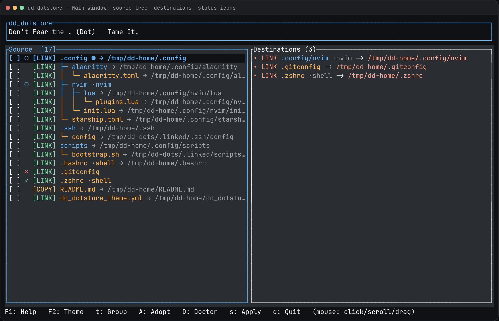

# dd_dotstore

Manage Linux dotfiles from a project folder. Assign a destination to each file or folder, then symlink or copy in bulk. The map is `.dd_dotstore.json` in that folder.

The terminal app is the behavior. The window, `dd_dotstore-gui`, calls the same actions, reads the same map, and writes the same file.



**Illustrated tutorial (install, first run, keys, screenshots):** [ldnddev.github.io/dd_dotstore](https://ldnddev.github.io/dd_dotstore/)

## Install

The installer detects Linux `x86_64` / `aarch64` and installs the musl terminal package from GitHub Releases, plus the theme. A window install is built from this checkout (`--gui` or `--both`). The window needs Vulkan and Wayland or X11.

```bash
curl -fsSL https://raw.githubusercontent.com/ldnddev/dd_dotstore/master/install.sh | bash

dd_dotstore --help
```

`GITHUB_TOKEN` is optional and only needed if you hit GitHub API rate limits.

From a source checkout, `./install.sh` asks for the terminal, the window, or both. The same question is asked on uninstall. Uninstall removes the chosen binaries and their `.desktop` files. It leaves the theme YAML, the icon, and `gui.json`.

| Flag or answer | Installs or removes |
|---|---|
| `--tui`, `1`, `tui`, `terminal` | `dd_dotstore` and its launcher |
| `--gui`, `2`, `gui`, `window` | `dd_dotstore-gui` and its launcher |
| `--both`, `3`, `both` | Both binaries and both launchers |
| no flag, with a tty | Prompt. Default is the terminal on install, both on uninstall |
| no flag, no tty | Terminal on install. Both on uninstall |
| `INSTALL_GUI=1` and no target flag | Same as `--both` |

Pass only one of `--tui`, `--gui`, and `--both`. Full options and PATH notes are in the [tutorial](https://ldnddev.github.io/dd_dotstore/#install).

## Run

```bash
cargo run
cargo run -- --root /path/to/dotfiles
cargo run -p dd_dotstore_gui -- --root /path/to/dotfiles
cargo test
cargo test -p dd_dotstore_gui --bin dd_dotstore-gui
```

Requires Rust 1.85+ (edition 2024) and a Unix-like OS (symlinks). `cargo build` and a terminal-only install do not compile the window. Build the window with `cargo build -p dd_dotstore_gui`.

Both programs take the same open flags:

```text
dd_dotstore [--root <path>] [path]
dd_dotstore-gui [--root <path>] [path]
```

`--root` and one positional path are the project folder. Passing both, or a second path, is an error. `-h` / `--help` and `-V` / `--version` print and exit. They do not open a window.

## Layout

The terminal header is four rows: the name, a theme quote, and a focus line. The window uses a title row (name and quote) and a focus row under it. The focus line is the highlighted item:

`LINK  .bashrc  →  /home/you/.bashrc  suggested (not saved)`

The status word is one of `linked`, `copied`, `planned`, `broken`, `unknown`, or `suggested (not saved)`. A saved group is shown as ` ·name` after the source path. A long line keeps the status word and the tail of the destination.

The body is two panes:

- **Source**, on the left. The project tree.
- **Destinations**, on the right. Only rows that have a saved destination. `->` is a symlink. `=>` is a copy. A group is ` ·name` on that row.

Destinations follows the cursor only when the highlighted saved path changes. A suggested path is not saved, so it does not highlight a Destinations row, and scrolling that pane keeps its place until the source cursor moves to a different saved path.

The footer is one line. `F1` and quit stay. Middle hints drop from the right when the window is narrow. While Settings or a dialog is open, the footer is `F1: Settings`, `Esc: Close`, and `Ctrl+Q: Quit`.

A toast sits above the footer for five seconds. The same words are used in both programs.

## Source rows

Each visible row is a checkbox, a status mark, `LINK` or `COPY`, the tree name, and, when nothing is saved yet, a dim `→` suggestion.

| Mark | Meaning |
|---|---|
| `✓` | Destination exists and matches (symlink target, or a copy on disk) |
| `✗` | Saved destination is broken or points somewhere else |
| `○` | Destination is saved and not on disk yet |
| `?` | Destination is saved and its metadata could not be read |
| `◌` | This folder has no destination of its own, and something inside it does |
| blank | Nothing assigned |

`●` on a folder name means a descendant is configured. A group name is ` ·name` on the row.

Checked rows are the bulk target. With nothing checked, the highlighted row is the target. Checking does not move the highlight.

## Where a destination comes from

A saved path wins. Otherwise the suggestion is:

| Source path | Suggestion |
|---|---|
| `.config` directory | `$XDG_CONFIG_HOME` or `~/.config` |
| `.config` file | `$HOME/.config` |
| `.config/<rest>` | `$XDG_CONFIG_HOME/<rest>` |
| One path segment, directory, name does not start with `.` | `$XDG_CONFIG_HOME/<name>` (`nvim` → `~/.config/nvim`) |
| One path segment otherwise | `$HOME/<name>` (`.bashrc`, `.ssh`) |
| Anything nested, or no `HOME` | `<project>/.linked/<relative path>` |

The `.linked` path is marked `[fallback: .linked]` in the plan. It is not written into the map until you apply or assign it.

## Map file

`.dd_dotstore.json` in the project root:

| Field | Role |
|---|---|
| `symlinks` | Relative source path → absolute destination |
| `modes` | `symlink` or `copy` per source. Missing means symlink |
| `groups` | Group name per source. Omitted when empty |
| `ignore_patterns` | Names skipped by the tree. Missing key keeps the built-in list. An empty list shows everything, including `.dd_dotstore.json` |
| `history` | Always written as `[]`. A loaded file's history is dropped |

Undo is the last 10 actions in this process. It is not replayed from the file. Quit does not ask to save. Edits flush after a short idle, and at once after apply, remove, group, ignore, import, export, and adopt. A failed save toasts and retries. The write uses a temp file and rename, so a symlink at the config path is replaced and not followed. A symlink or non-file theme or config is refused.

Built-in ignore names, until you save a list: `.git`, `node_modules`, `target`, `__pycache__`, `.dd_dotstore.json`, `.DS_Store`, `.linked`.

## Actions

Both programs use these keys. In the window, `j` `k` `h` `l` `g` `G` also require **Vim keys** (on by default, stored in `gui.json`). Arrows, letters that are commands (`m`, `s`, `t`, …), and `Ctrl+G` always work. A bare `q` does not quit. `Ctrl+Q` quits. A text field swallows letters that would otherwise be commands.

| Key | Action |
|---|---|
| `j` / `k` or `↑` / `↓` | Move the highlight |
| `Ctrl+G` / `G` | First row / last row. Window: `g` / `G` when Vim keys is on |
| `Space` | Toggle the checkbox on the highlight |
| `Enter` or `e` | Destination browser for the highlight |
| `h` / `l` or `←` / `→` | Collapse / expand a folder |
| `m` | Toggle `LINK` / `COPY` on the highlight |
| `M` | Set every checked row to the other mode. With nothing checked, same as `m` |
| `s` or `p` | Plan apply for the target rows. `Y` or `Enter` applies |
| `x` | Plan remove. `Y` or `Enter` removes |
| `u` | Undo the last apply, remove, or copy in this session (cap 10) |
| `/` | Filter the source tree. Matches names and group names. `Esc` restores the previous filter. `Enter` keeps it. Clear a committed filter with `Esc` |
| `r` | Reload the tree from disk and keep the live map |
| `t` | Name a group on the target rows. Empty clears it |
| `T` | Check every row in the highlight's group |
| `A` | Adopt symlinks under `$HOME` and XDG that point into this project and are not in the map |
| `D` | Doctor |
| `I` | Ignore editor |
| `i` | Import a JSON export |
| `E` | Export the map to `~/.dd_dotstore/exports/` |
| `F1` or `F2` | Settings. Same sheet. A second press closes it and restores the theme from when it opened |
| `F3` | Settings, About page |
| `Esc` | Close the top dialog, then clear the filter, then clear checkboxes. Does not quit |

In a plan or overwrite dialog, `j` / `k` scroll and any other key cancels. Apply does not run until `Y` or `Enter`.

If apply would replace a real file or directory (not an existing symlink, unless the row is `COPY`), the overwrite dialog lists them. Directories are deleted with a recursive remove. `Y` or `Enter` continues. Anything else cancels.

Remove deletes the symlink we created, or the copied file or directory. It does not delete a real file that merely sits at a symlink destination.

The destination browser starts at `$HOME`. Type to filter. `Enter`, `→`, or `l` opens a directory or assigns a file. `Backspace`, `←`, or `h` edits the filter, or goes to the parent when the filter is empty. `~` returns to `$HOME`. `g` / `G` jump when the filter is empty. `Ctrl+S` assigns `<current>/<source name>` without picking a file. `Ctrl+U` clears the filter. `Esc` closes without assigning.

Ignore editor: `j` / `k` move, `d` or `Delete` removes, `Enter` adds the draft, `Esc` closes. The list is saved.

Import lists `~/.dd_dotstore/exports/*.json`, newest first. `Enter` loads `symlinks`, `modes`, `groups`, and `ignore_patterns` when that key is present. On-disk undo history is ignored.

Export asks for a file name. `Enter` writes it and adds `.json` if needed.

Group: type the name, `Enter` saves, empty clears, `Esc` cancels.

Adopt: `Space` toggles a row, `a` toggles all, `Y` or `Enter` saves the checked rows (or the highlight when nothing is checked). `Esc` cancels.

Doctor lists broken, planned, unknown, and orphan links (symlinks into this project that are not in the map). `Enter` jumps to that source and expands its parents. `A` opens adopt. `Esc` closes.

## Mouse

| Action | Result |
|---|---|
| Click a source row | Highlight it |
| Click the checkbox | Toggle select |
| Click the folder twist | Expand or collapse |
| Shift+click | Check every row from the previous highlight through the click |
| Double-click a row | Destination browser |
| Wheel over a pane | Scroll that pane. The terminal also pulls the source highlight into view. The window leaves the highlight where it is |
| Click a Destinations row | Highlight that source and expand its parents |
| Click outside a dialog | Close it. A click inside a plan or overwrite dialog does nothing |
| Click a dialog row | Highlight it. Double-click confirms that row |

## Settings and theme

`F1` opens one sheet. `F2`, and in the window `Ctrl+/` and `Ctrl+,`, open and close that same sheet. The terminal sheet is the right half of the body. The window sheet is 70% of the body, under the header and above the footer. The editor underneath keeps its place.

Terminal pages, in order: **Themes**, **About**, **Help**.

Window pages, in order: **Themes**, **Window**, **About**, **Help**. Themes is first. Help is last. `Tab` and `Shift+Tab`, and `[` `]` when a hex field is not focused, change the page.

The window pins Search at the top of the nav. `/` focuses it. A query replaces the page with Results. `Esc` clears the query and leaves the sheet open. The next `Esc` closes the sheet and restores the theme snapshot from when it opened. The terminal sheet has no search field.

Themes: Omarchy names when they are installed, otherwise the color editor directly. `↑` `↓` preview. `Enter` applies the highlighted name again. `e` opens colors. `t` toggles the save target (`global` / `local`). `y` or `s` writes the palette and closes the sheet. `Esc` in the color editor returns to the name list when there is one, then reverts and closes.

Theme files, first match wins:

1. `./dd_dotstore_theme.yml` next to the project
2. `$XDG_CONFIG_HOME/ldnddev/dd_dotstore_theme.yml`, or `~/.config/ldnddev/dd_dotstore_theme.yml`
3. Built-in colors

`Follow` tracks the desktop theme and re-reads it while Settings is closed. A missing Omarchy theme keeps the built-in palette and says so. Colors are not stored in `.dd_dotstore.json`.

Window preferences live in `$XDG_CONFIG_HOME/ldnddev/dd_dotstore/gui.json` (or `~/.config/ldnddev/dd_dotstore/gui.json`). They are not in the map and not in the theme file.

```json
{
  "density": "comfortable",
  "vim_keys": true,
  "reduced_motion": false
}
```

`comfortable` rows are 28px. `compact` rows are 24px. Reduced motion applies theme changes immediately. The window opens at 1280×800. Its app id is `dev.ldnddev.dd_dotstore`.

About (`F3`) is credits and the theme source. Help is the key list. In the window, Help is the shared shortcut sheet (`Settings · F1 · F1` is the first row).

## License

MIT
